# Architecture and UI Data Flow Specification
**Project 357: Kubernetes-Based Auto-Scaling Framework**  
**Alliance University, Bengaluru &bull; Design Project-I**

---

## 1. End-to-End Architectural Pipeline

The diagram below reflects the exact data flow implemented in the framework codebase:

```mermaid
flowchart TD
    subgraph DataCollection["1. Telemetry Ingestion"]
        A1["Prometheus HTTP API (/api/v1/query)"] --> A2["PrometheusTelemetryProvider (telemetry.py)"]
        A3["SimulatedTelemetryProvider (Explicit Demo Mode)"] -.-> A2
    end

    subgraph TelemetryValidation["2. Telemetry Processing & Safety Check"]
        A2 --> B1{"Freshness & Availability Check"}
        B1 -- "Timestamp Age > 60s (STALE) or Empty (MISSING)" --> B2["Mark Metric Degraded (is_usable=False)"]
        B1 -- "Timestamp <= 60s & Numeric Value Valid" --> B3["MetricSample(status=VALID)"]
    end

    subgraph PolicyEvaluation["3. Policy Engine Evaluation"]
        B3 --> C1["PolicyEngine (policy_engine.py)"]
        C1 --> C2["Load YAML Rules (scaling-policies.yaml)"]
        C2 --> C3{"Evaluate Condition per Rule\n(>, <, >=, <=)"}
        C3 -- "Condition True" --> C4{"Check Duration Window\n(Breach Elapsed >= Duration?)"}
        C4 -- "Yes" --> C5["PolicyEvaluationResult(matched=True)"]
        C4 -- "No" --> C6["PolicyEvaluationResult(matched=False, reason=Persistence pending)"]
        C3 -- "No" --> C7["PolicyEvaluationResult(matched=False)"]
    end

    subgraph DecisionArbitration["4. PRAH Decision Controller"]
        B2 --> D0["Safe Fallback Triggered"]
        D0 --> D1["Decision: HOLD\n(Explanation: Telemetry degraded)"]
        C5 --> D2["Collect Competing Proposals"]
        C6 --> D2
        C7 --> D2
        D2 --> D3{"Any Matched Proposals?"}
        D3 -- "No" --> D4["Decision: HOLD\n(Nominal Equilibrium)"]
        D3 -- "Yes" --> D5["Sort Candidates by Priority Descending"]
        D5 --> D6{"Priority Tie?\n(Multiple top candidates)"}
        D6 -- "Scale-Out vs Scale-In Conflict" --> D7["Scale-Out Wins (SLA Preservation Rule)"]
        D6 -- "Single Top Rule" --> D8["Select Highest Priority Rule"]
        D7 --> D9{"Anti-Flapping Check\n(Direction flip within 30s?)"}
        D8 --> D9
        D9 -- "Yes" --> D10["Decision: HOLD\n(Hysteresis Active)"]
        D9 -- "No" --> D11{"Cooldown Active?\n(Elapsed < Cooldown Seconds?)"}
        D11 -- "Yes" --> D12["Decision: HOLD\n(Cooldown Active)"]
        D11 -- "No" --> D13["Approved Proposal -> Decision(SCALE_OUT / SCALE_IN)"]
    end

    subgraph GuardrailsAndOwnership["5. Guardrails & Ownership Coordination"]
        D13 --> E1["StrategyCoordinator (strategy_coordinator.py)"]
        E1 --> E2{"Check Competing HPA"}
        E2 -- "Conflict Detected" --> E3["REJECTED: Competing HPA Active"]
        E2 -- "No Conflict" --> E4["GuardrailEngine (guardrails.py)"]
        E4 --> E5{"Validate Replica Bounds\n[min_replicas, max_replicas]"}
        E5 -- "Target < min or Target > max" --> E6["Reject or Clamp to Bound"]
        E5 -- "Within Bounds" --> E7{"Check Step-Size Limits\n(max_step_up, max_step_down)"}
        E7 --> E8["Authorized Target Replicas"]
        E8 --> E9{"Mode Check"}
        E9 -- "dry_run == True" --> E10["Preview Mode (No cluster write)"]
        E9 -- "enable_live_execution == True" --> E11["Authorize Live Execution"]
    end

    subgraph ClusterExecution["6. Kubernetes Execution & Verification"]
        E11 --> F1["KubernetesExecutor (kubernetes_executor.py)"]
        F1 --> F2["patch_namespaced_deployment_scale()"]
        F2 --> F3["Poll Deployment Status until spec.replicas matches"]
        F3 -- "Verified" --> F4["ExecutionResult(success=True, verified=True)"]
        F3 -- "Timeout / Error" --> F5["ExecutionResult(success=False, error=Details)"]
    end

    subgraph LoggingAndUI["7. Audit Logging & Dashboard Surface"]
        D1 --> G1["DecisionLogger (decision_logger.py)"]
        D4 --> G1
        D10 --> G1
        D12 --> G1
        E10 --> G1
        F4 --> G1
        F5 --> G1
        G1 --> G2["Append to logs/decisions.jsonl"]
        G1 --> G3["Update In-Memory Ring Buffer (max 200)"]
        G3 --> H1["Dashboard REST API (dashboard/app.py)"]
        H1 --> H2["Operator UI (index.html / dashboard.js)"]
    end
```

---

## 2. Component Interaction & Communication Protocol

| Step | From Module | To Module | Data Transferred | Protocol / Mechanism |
| :--- | :--- | :--- | :--- | :--- |
| **1** | `telemetry.py` | Prometheus | HTTP GET `/api/v1/query?query=...` | HTTP / JSON Vector |
| **2** | `telemetry.py` | `policy_engine.py` | `Dict[str, MetricSample]` | Internal Python Dataclass |
| **3** | `policy_engine.py` | `decision_controller.py` | `List[PolicyEvaluationResult]` | Internal Python Dataclass |
| **4** | `decision_controller.py` | `strategy_coordinator.py` | `Decision` instance | Internal Python Dataclass |
| **5** | `strategy_coordinator.py` | `guardrails.py` | Proposed target, delta, current | Internal Python Method |
| **6** | `guardrails.py` | `kubernetes_executor.py` | `GuardrailResult(approved=True, target)` | Internal Python Dataclass |
| **7** | `kubernetes_executor.py` | Kubernetes API | PATCH `/apis/apps/v1/.../deployments/sample-web-app/scale` | HTTPS / OpenAPI Client |
| **8** | `kubernetes_executor.py` | Kubernetes API | GET `/apis/apps/v1/.../deployments/sample-web-app` | HTTPS / OpenAPI Client |
| **9** | `decision_controller.py` | `decision_logger.py` | Atomic cycle summary dict | Thread-safe in-memory + JSONL |
| **10** | `dashboard/app.py` | Browser UI (`dashboard.js`)| JSON API responses (`/api/status`, `/api/metrics`, etc.) | HTTP REST Polling (3s) |

---

## 3. Strict Deterministic Design Guarantees

1. **Zero Artificial Intelligence / Machine Learning**: No statistical forecasting, no linear regression, no neural networks, and no stochastic models.
2. **100% Explainability**: Every scaling decision outputs a human-readable explanation string detailing the exact rule triggered, priority comparison, and mathematical threshold evaluated.
3. **Defense-in-Depth Safety Gate**: The `GuardrailEngine` operates independently from the `DecisionController`. Even if a policy requests 50 replicas, the guardrail rejects or clamps it to `max_replicas: 10`.
4. **Idempotence & Anti-Flapping**: Consecutive opposing actions (e.g. Scale-Out immediately followed by Scale-In) are intercepted by the hysteresis band, ensuring cluster stability.
