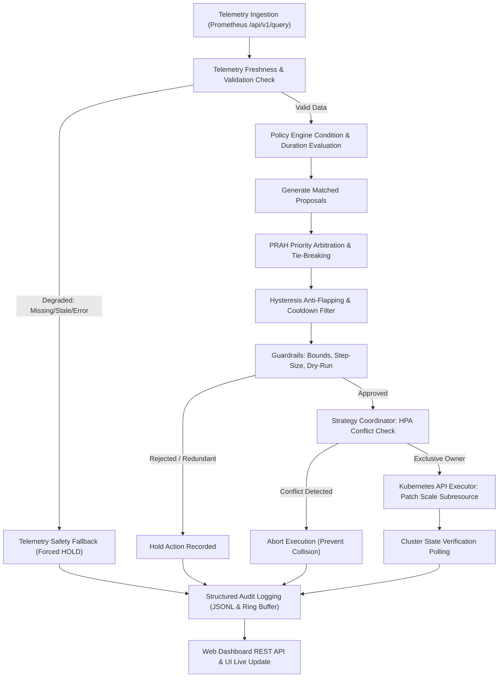

# PROJECT 357 — End-to-End Execution Flow Specification

**Project Title:** Kubernetes-Based Auto-Scaling Framework for Cloud Applications  
**Algorithm:** PRAH (*Priority-based Rule Arbitration with Hysteresis*)  
**Execution Cycle Version:** 1.0  
**Project ID:** 357 | Alliance University, Bengaluru  

---

## 1. System Control Loop Overview

The framework operates an autonomous, deterministic, single-threaded control cycle executed either periodically (default: every 10 seconds) by [`AutoscalingController.start_loop()`](file:///C:/Users/SRIRAM/design_project/controller/main.py#L206-L230) or on-demand via the web console REST API.



---

## 2. Detailed Step-by-Step Code Path

### Step 1: Workload State Assessment
* **Function:** [`AutoscalingController.run_single_cycle()`](file:///C:/Users/SRIRAM/design_project/controller/main.py#L134) calling [`KubernetesExecutor.get_workload_state()`](file:///C:/Users/SRIRAM/design_project/controller/kubernetes_executor.py#L141).
* **Action:** Queries `AppsV1Api.read_namespaced_deployment` and `CoreV1Api.list_namespaced_pod`.
* **Data Extracted:**
  - `spec.replicas` (desired replica count)
  - `status.replicas` (observed replica count)
  - `status.ready_replicas` (pods passing readiness probes)
  - `status.unavailable_replicas`
  - Individual pod names, phases, container restart counts, and host node names.
* **Offline Handling:** If the cluster is unreachable, returns `WorkloadState` with `connected = False` and simulated replica count (default: 2).

---

### Step 2: Telemetry Ingestion & PromQL Querying
* **Function:** [`AutoscalingController.fetch_current_telemetry()`](file:///C:/Users/SRIRAM/design_project/controller/main.py#L113) calling [`PrometheusTelemetryProvider.query_instant()`](file:///C:/Users/SRIRAM/design_project/controller/telemetry.py#L69).
* **Target Queries:** Generated by [`build_metric_queries()`](file:///C:/Users/SRIRAM/design_project/controller/telemetry.py#L257):
  - `cpu_utilization_percent`: Container CPU usage rate vs CPU resource limit.
  - `memory_utilization_percent`: Working set bytes vs memory resource limit.
  - `http_requests_per_second`: Sample app request counter rate over 1-minute window.
* **HTTP Target:** `GET /api/v1/query?query={promql}` against Prometheus (timeout: 1.5s).

---

### Step 3: Telemetry Health & Staleness Validation
* **Function:** [`PrometheusTelemetryProvider.query_instant()`](file:///C:/Users/SRIRAM/design_project/controller/telemetry.py#L69) and [`MetricSample.is_usable()`](file:///C:/Users/SRIRAM/design_project/controller/telemetry.py#L40).
* **Validation Rules:**
  1. If HTTP status $\neq 200 \implies \text{MetricStatus.ERROR}$.
  2. If result vector is empty $\implies \text{MetricStatus.MISSING}$.
  3. If timestamp age $(\text{now} - \text{sample\_timestamp}) > 60.0\text{s} \implies \text{MetricStatus.STALE}$.
  4. If floating-point parsing fails $\implies \text{MetricStatus.ERROR}$.
* **Fallback Gate:** In [`DecisionController.compute_decision()`](file:///C:/Users/SRIRAM/design_project/controller/decision_controller.py#L127-L148):
  If any required metric is `MISSING`, `STALE`, or `ERROR`, the decision engine **immediately bypasses scaling** and outputs a safe fallback:
  ```python
  Decision(
      action="HOLD",
      proposed_replica_delta=0,
      selected_policy_id="FALLBACK_TELEMETRY_INVALID",
      selected_policy_name="Telemetry Safety Fallback",
      priority=999,
      explanation="PRAH Fallback Triggered: Telemetry safety check failed... Holding replica count."
  )
  ```

---

### Step 4: Policy Engine Evaluation
* **Function:** [`PolicyEngine.evaluate()`](file:///C:/Users/SRIRAM/design_project/controller/policy_engine.py#L202).
* **Evaluation Logic:**
  - Iterates through all enabled `PolicyRule` objects loaded from YAML.
  - Evaluates mathematical condition (`val operator threshold`) using [`SUPPORTED_OPERATORS`](file:///C:/Users/SRIRAM/design_project/controller/policy_engine.py#L22).
  - **Duration Persistence:**
    - If condition is met for the first time, records `_breach_timestamps[rule.id] = now`.
    - If elapsed time $\ge \text{duration\_seconds} \implies \text{matched = True}$.
    - If elapsed time $< \text{duration\_seconds} \implies \text{matched = False}$ with diagnostic reason reporting remaining seconds.
    - If condition fails, removes `rule.id` from `_breach_timestamps`.

---

### Step 5: Proposal Generation & PRAH Arbitration
* **Function:** [`DecisionController.compute_decision()`](file:///C:/Users/SRIRAM/design_project/controller/decision_controller.py#L150-L233).
* **Phase A — Proposal Collection:** Converts matched evaluation results into candidate `Proposal` objects.
* **Phase B — Nominal State:** If zero policies match, returns `action="HOLD"` (nominal workload state).
* **Phase C — Priority Arbitration:**
  - Sorts candidate proposals by `priority` descending.
  - Filters candidates matching the highest priority (`top_candidates`).
* **Phase D — Deterministic Conflict Resolution (Tie-Breaking):**
  - If competing `SCALE_OUT` and `SCALE_IN` share top priority:
    > **Tie-Breaking Rule:** `SCALE_OUT` wins to preserve service availability and uphold SLAs.
  - Multiple `SCALE_OUT` candidates $\to$ selects largest replica delta.
  - Multiple `SCALE_IN` candidates $\to$ selects most conservative replica delta (closest to 0).

---

### Step 6: Anti-Flapping Hysteresis & Cooldown Verification
* **Function:** [`DecisionController.compute_decision()`](file:///C:/Users/SRIRAM/design_project/controller/decision_controller.py#L234-L290).
* **Hysteresis Suppression:**
  - Checks if proposed action is opposite to `last_action_direction` (e.g., `SCALE_IN` immediately following `SCALE_OUT`).
  - If elapsed time $< 30.0\text{s}$, the action is suppressed and converted to `HOLD` with explanation: `PRAH Hysteresis Protection: Anti-flapping delay active`.
* **Directional Cooldown:**
  - Checks if elapsed time $< \text{cooldown\_duration}$ (default: 60s).
  - If active, the action is suppressed and converted to `HOLD`.

---

### Step 7: Single Ownership Coordination & Guardrail Approval
* **Function:** [`StrategyCoordinator.coordinate_and_execute()`](file:///C:/Users/SRIRAM/design_project/controller/strategy_coordinator.py#L75) calling [`GuardrailEngine.validate_action()`](file:///C:/Users/SRIRAM/design_project/controller/guardrails.py#L69).
* **Single Ownership Guard:** Queries `AutoscalingV2Api.list_namespaced_horizontal_pod_autoscaler`. If another autoscaler is targeting the same deployment, execution is aborted to prevent competing writes.
* **Operational Guardrail Checks:**
  1. Redundant check: `target_replicas == current_replicas \implies \text{HOLD}`.
  2. Step clamping:
     - `SCALE_OUT` delta clamped to `+max_scale_step_up` (default: +2).
     - `SCALE_IN` delta clamped to `-max_scale_step_down` (default: -1).
  3. Minimum replica boundary:
     - If current $\le 1$ and action is `SCALE_IN` $\implies \text{REJECTED}$.
     - Clamps target $\ge 1$.
  4. Maximum replica boundary:
     - If current $\ge 10$ and action is `SCALE_OUT` $\implies \text{REJECTED}$.
     - Clamps target $\le 10$.
  5. Execution mode gating:
     - If `dry_run = True` or `enable_live_execution = False` $\implies$ marked as `DRY RUN PREVIEW`.

---

### Step 8: Kubernetes Execution & Subresource Mutation
* **Function:** [`KubernetesExecutor.execute_scaling()`](file:///C:/Users/SRIRAM/design_project/controller/kubernetes_executor.py#L244).
* **In Dry-Run Mode:**
  - Skips cluster API mutation.
  - Updates local simulated replica state and logs preview message.
* **In Live Execution Mode:**
  - Sends JSON patch to Kubernetes scale subresource:
    ```python
    scale_patch = {"spec": {"replicas": target_replicas}}
    client.AppsV1Api().patch_namespaced_deployment_scale(
        name="sample-web-app",
        namespace="autoscaling-demo",
        body=scale_patch,
    )
    ```

---

### Step 9: Actual-State Verification & Convergence Polling
* **Function:** [`KubernetesExecutor.execute_scaling()`](file:///C:/Users/SRIRAM/design_project/controller/kubernetes_executor.py#L323-L363).
* **Verification Loop:**
  - Polls Kubernetes API every 1.0 second until `spec.replicas == target_replicas` or timeout (15.0s) expires.
  - Confirms updated replica count before reporting success.
  - If timeout expires before cluster converges, reports failure with `VerificationTimeout`.

---

### Step 10: Audit Logging & Dashboard Synchronization
* **Function:** [`DecisionLogger.log_cycle()`](file:///C:/Users/SRIRAM/design_project/controller/decision_logger.py#L60).
* **Actions:**
  1. Formats complete record: timestamp, decision, guardrail outcome, execution result, telemetry snapshot, and error notes.
  2. Appends record to in-memory deque (ring buffer of 200 items).
  3. Appends structured line to [`logs/decisions.jsonl`](file:///C:/Users/SRIRAM/design_project/logs/decisions.jsonl).
  4. If execution succeeded and action was `EXECUTE`, records action timestamp and direction in `DecisionController` to arm cooldown.
  5. Web console polls [`/api/decisions`](file:///C:/Users/SRIRAM/design_project/dashboard/app.py#L160) and [`/api/history`](file:///C:/Users/SRIRAM/design_project/dashboard/app.py#L174) to update UI meters, badges, and the audit table in real time.
