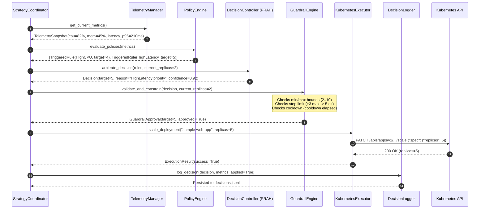

# System Architecture: KubePilot Autoscaling Framework

## 1. Architectural Overview

**KubePilot** implements an autonomous, closed-loop control system that monitors, decides, validates, and executes pod scaling operations for Kubernetes workloads. The framework decouples policy definition, metric collection, decision arbitration, and Kubernetes cluster mutation into distinct, loosely-coupled modules.

```
                           +-------------------------------------+
                           |        Human Operators / CI/CD      |
                           +-------------------------------------+
                                              |
                                              v
                               +-----------------------------+
                               |  Web Dashboard & REST APIs  |
                               |  (Flask :5055 / Chart.js)   |
                               +-----------------------------+
                                              |
+---------------------------------------------v------------------------------------------------+
|                                    KUBEPILOT CONTROL PLANE                                   |
|                                                                                              |
|   +--------------------------+                         +---------------------------------+   |
|   |   Telemetry Collector    |                         |          Policy Engine          |   |
|   |  (Prometheus / cAdvisor) |                         |  (scaling-policies.yaml Parser) |   |
|   +--------------------------+                         +---------------------------------+   |
|                \                                                       /                     |
|                 \                     Metric Vector                   /                      |
|                  +--------------------------+------------------------+                       |
|                                             |                                                |
|                                             v                                                |
|                              +-----------------------------+                                 |
|                              |    PRAH Decision Engine     |                                 |
|                              |   (Multi-Rule Arbitration)  |                                 |
|                              +-----------------------------+                                 |
|                                             |                                                |
|                                     Raw Scaling Action                                       |
|                                             |                                                |
|                                             v                                                |
|                              +-----------------------------+                                 |
|                              |      Guardrail Engine       |                                 |
|                              | (Bounds, Hysteresis, Cool)  |                                 |
|                              +-----------------------------+                                 |
|                                       /            \                                         |
|                       Safe Action    /              \  Decision Record                       |
|                                     v                v                                       |
|                       +-------------------+    +-------------------+                         |
|                       |  K8s Executor     |    |  Decision Logger  |                         |
|                       | (Scale Subres)    |    | (decisions.jsonl) |                         |
|                       +-------------------+    +-------------------+                         |
+---------------------------------|------------------------------------------------------------+
                                  |
                                  | HTTPS / kube-api
                                  v
+----------------------------------------------------------------------------------------------+
|                                   KUBERNETES CLUSTER                                         |
|                                                                                              |
|   +--------------------------------------------------------------------------------------+   |
|   | Namespace: autoscaling-demo                                                          |   |
|   |                                                                                      |   |
|   |   +------------------------------------------------------------------------------+   |   |
|   |   | Deployment: sample-web-app                                                   |   |   |
|   |   |                                                                              |   |   |
|   |   |   [ Pod 1 (Ready) ]     [ Pod 2 (Ready) ]     ...     [ Pod N (Dynamic) ]    |   |   |
|   |   +------------------------------------------------------------------------------+   |   |
|   +--------------------------------------------------------------------------------------+   |
|                                                                                              |
|   +--------------------------+                          +--------------------------------+   |
|   |  Prometheus Monitoring   |                          |    Kubernetes Metrics Server   |   |
|   |  (Port 9090 / Metrics)   |                          |   (CPU/Mem Resource Metrics)   |   |
|   +--------------------------+                          +--------------------------------+   |
+----------------------------------------------------------------------------------------------+
```

---

## 2. Component Topology

### 2.1 Telemetry Collector (`controller/telemetry.py`)
Responsible for continuous telemetry ingestion.
* Queries Prometheus via standard HTTP API (`/api/v1/query`) using vector PromQL expressions for CPU utilization, memory usage, request rate, p95 latency, and 5xx error rate.
* Includes dynamic fallback to `kubernetes.client.CustomObjectsApi` for raw cluster metrics when Prometheus queries time out.
* Implements a deterministic synthetic mock generator when running in offline development or test environments.

### 2.2 Policy Engine (`controller/policy_engine.py`)
Manages declarative scaling rules loaded from `policies/scaling-policies.yaml`.
* Validates rule syntax, target metrics, comparison operators (`>`, `>=`, `<`, `<=`), thresholds, priority weights, and target replica calculations.
* Evaluates incoming telemetry vectors against all active policies, identifying triggered conditions and calculating recommended replica counts per rule.

### 2.3 PRAH Decision Controller (`controller/decision_controller.py`)
Executes the **Policy-Driven Reactive-Arbitration Heuristic (PRAH)**:
* Ingests recommendations from all triggered policies.
* In the event of competing recommendations (e.g., CPU suggests scale up to 4 while Memory suggests scale up to 3), PRAH prioritizes based on policy priority weight, severity magnitude, and safety bias.
* Resolves conflict towards the maximum safe target for scale-up requests (fail-safe for availability) and conservative evaluation for scale-down requests.
* Produces an unconstrained scaling recommendation tagged with confidence score and trigger rationale.

### 2.4 Guardrail Engine (`controller/guardrails.py`)
Enforces cluster stability, operational constraints, and economic bounds:
* **Absolute Bounds:** Enforces `min_replicas: 2` (preventing single-pod SPOF) and `max_replicas: 10` (preventing cluster resource exhaustion).
* **Step-Rate Limits:** Enforces `max_scale_up_step: 3` and `max_scale_down_step: 1` to ensure controlled transitions.
* **Cooldown Timers:** Implements asymmetric cooldown periods—60 seconds after scale-up, 180 seconds after scale-down—preventing thrashing.
* **Hysteresis Smoothing:** Maintains a 5-sample sliding window of recent metrics to prevent transient spikes from triggering premature scaling.
* **Flapping Detection:** Flags rapid directional reversals within a configurable observation window.

### 2.5 Kubernetes Executor (`controller/kubernetes_executor.py`)
Performs authenticated mutations against the Kubernetes API:
* Dynamically detects cluster configuration: in-cluster service account tokens or local kubeconfig (`~/.kube/config`).
* Employs resilient auto-reconnection logic with exponential backoff if the cluster restarts or connection drops.
* Scales deployments cleanly via the `AppsV1Api.patch_namespaced_deployment_scale` subresource.
* Queries real-time pod operational status (`Running`, `Ready`, `Pending`, `CrashLoopBackOff`).

### 2.6 Strategy Coordinator (`controller/strategy_coordinator.py`)
Orchestrates the continuous reconciliation loop:
* Runs periodically (default interval: 10 seconds) on a managed background worker thread.
* Sequentially coordinates: Telemetry Ingestion -> Policy Evaluation -> PRAH Arbitration -> Guardrail Enforcement -> Cluster Actuation -> Audit Logging.
* Exposes clean control methods (`start()`, `stop()`, `evaluate_once()`) for embedding within both standalone daemon mode and the web dashboard.

### 2.7 Decision Logger (`controller/decision_logger.py`)
Maintains an immutable, append-only audit trail:
* Writes structured JSON lines to `logs/decisions.jsonl`.
* Captures timestamp, current replicas, recommended replicas, final approved replicas, applied status, cooldown state, triggered policy names, and instantaneous telemetry snapshot.

---

## 3. Data Pipeline & Scaling Reconciliation Loop

The following sequence diagram illustrates the lifecycle of a single reconciliation cycle:



---

## 4. PRAH Decision Arbitration Flow

```
                      +-----------------------------+
                      | Incoming Telemetry Snapshot |
                      +-----------------------------+
                                     |
                                     v
                      +-----------------------------+
                      | Evaluate YAML Policy Rules  |
                      +-----------------------------+
                                     |
                 +-------------------+-------------------+
                 |                                       |
          No Rules Match                           >=1 Rules Match
                 |                                       |
                 v                                       v
    +-------------------------+             +-------------------------+
    | Recommendation: NOOP    |             | Sort by Priority Weight |
    | Keep Current Replicas   |             +-------------------------+
    +-------------------------+                          |
                 |                                       v
                 |                          +-------------------------+
                 |                          | Direction Arbitration   |
                 |                          | Scale-Up vs Scale-Down  |
                 |                          +-------------------------+
                 |                                       |
                 |               +-----------------------+-----------------------+
                 |               |                                               |
                 |       Any Rule Demands UP?                             All Demand DOWN?
                 |               |                                               |
                 |               v                                               v
                 |    +---------------------+                         +---------------------+
                 |    | Take Max Target UP  |                         | Take Conservative   |
                 |    | (Availability Bias) |                         | Target DOWN         |
                 |    +---------------------+                         +---------------------+
                 |               |                                               |
                 +---------------+-----------------------+-----------------------+
                                                         |
                                                         v
                                          +-----------------------------+
                                          | Validate Against Guardrails |
                                          | Bounds, Cooldown, Step Rate |
                                          +-----------------------------+
                                                         |
                                                         v
                                          +-----------------------------+
                                          | Execute Cluster Mutation    |
                                          +-----------------------------+
```

---

## 5. State Machine: Cooldown and Hysteresis

The Guardrail Engine tracks operational state transitions across time to eliminate rapid scaling oscillation:

```
               +---------------------------------------+
               |               STABLE                  |
               |       Replicas: N, Cooldown: Inactive |
               +---------------------------------------+
                 /                                   \
  Traffic Surge /                                     \ Sustained Lull
  Metrics > Up Threshold                               \ Metrics < Down Threshold
               /                                       \
              v                                         v
+-----------------------------+           +-----------------------------+
|          SCALE_UP           |           |         SCALE_DOWN          |
| Target: N + step (step <= 3)|           | Target: N - 1 (step = 1)    |
| Replicas Updated to N + step|           | Replicas Updated to N - 1   |
+-----------------------------+           +-----------------------------+
              |                                         |
              v                                         v
+-----------------------------+           +-----------------------------+
|     COOLDOWN_SCALE_UP       |           |     COOLDOWN_SCALE_DOWN     |
| Duration: 60 Seconds        |           | Duration: 180 Seconds       |
| Further Scale-Down Blocked  |           | Further Scale-Down Blocked  |
+-----------------------------+           +-----------------------------+
              \                                         /
               \               Timer Expired           /
                +----------------->+<-----------------+
                                   |
                                   v
                             Return to STABLE
```
