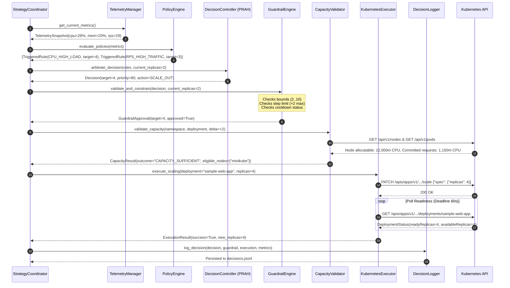

# System Architecture: KubePilot Autoscaling Framework

## 1. Architectural Overview

**KubePilot** implements an autonomous, closed-loop control system that monitors, decides, validates, and executes pod scaling operations for Kubernetes workloads. The framework decouples policy definition, metric collection, decision arbitration, capacity admission validation, and Kubernetes cluster mutation into distinct, loosely-coupled modules.

```
                           +-------------------------------------+
                           |        Human Operators / CI/CD      |
                           +-------------------------------------+
                                              |
                                              v
                               +-----------------------------+
                               |  Web Dashboard & REST APIs  |
                               |  (Flask :5055 / Chart.js)   |
                               +-----------------------------+
                                              |
+---------------------------------------------v------------------------------------------------+
|                                    KUBEPILOT CONTROL PLANE                                   |
|                                                                                              |
|   +--------------------------+                         +---------------------------------+   |
|   |   Telemetry Collector    |                         |          Policy Engine          |   |
|   |  (Prometheus / cAdvisor) |                         |  (scaling-policies.yaml Parser) |   |
|   +--------------------------+                         +---------------------------------+   |
|                \                                                       /                     |
|                 \                     Metric Vector                   /                      |
|                  +--------------------------+------------------------+                       |
|                                             |                                                |
|                                             v                                                |
|                              +-----------------------------+                                 |
|                              |    PRAH Decision Engine     |                                 |
|                              |   (Multi-Rule Arbitration)  |                                 |
|                              +-----------------------------+                                 |
|                                             |                                                |
|                                     Raw Scaling Action                                       |
|                                             |                                                |
|                                             v                                                |
|                              +-----------------------------+                                 |
|                              |      Guardrail Engine       |                                 |
|                              | (Bounds, Hysteresis, Cool)  |                                 |
|                              +-----------------------------+                                 |
|                                             |                                                |
|                                    Authorized Scaling Plan                                   |
|                                             |                                                |
|                                             v                                                |
|                              +-----------------------------+                                 |
|                              |     Capacity Validator      |                                 |
|                              | (Node Allocatable Headroom) |                                 |
|                              +-----------------------------+                                 |
|                                       /            \                                         |
|                       Verified Plan  /              \  Decision Record                       |
|                                     v                v                                       |
|                       +-------------------+    +-------------------+                         |
|                       |  K8s Executor     |    |  Decision Logger  |                         |
|                       | (Scale & Verify)  |    | (decisions.jsonl) |                         |
|                       +-------------------+    +-------------------+                         |
+---------------------------------|------------------------------------------------------------+
                                  |
                                  | HTTPS / kube-api (Scale subresource + Readiness Watch)
                                  v
+----------------------------------------------------------------------------------------------+
|                                   KUBERNETES CLUSTER                                         |
|                                                                                              |
|   +--------------------------------------------------------------------------------------+   |
|   | Namespace: autoscaling-demo                                                          |   |
|   |                                                                                      |   |
|   |   +------------------------------------------------------------------------------+   |   |
|   |   | Deployment: sample-web-app                                                   |   |   |
|   |   |                                                                              |   |   |
|   |   |   [ Pod 1 (Ready) ]     [ Pod 2 (Ready) ]     ...     [ Pod N (Dynamic) ]    |   |   |
|   |   +------------------------------------------------------------------------------+   |   |
|   |   +------------------------------------------------------------------------------+   |   |
|   |   | PersistentVolumeClaim: kubepilot-policies-pvc (Active Policy Persistence)    |   |   |
|   |   +------------------------------------------------------------------------------+   |   |
|   +--------------------------------------------------------------------------------------+   |
|                                                                                              |
|   +--------------------------+                          +--------------------------------+   |
|   |  Prometheus Monitoring   |                          |    Kubernetes Metrics Server   |   |
|   |  (Port 9090 / cAdvisor)  |                          |   (CPU/Mem Resource Metrics)   |   |
|   +--------------------------+                          +--------------------------------+   |
+----------------------------------------------------------------------------------------------+
```

---

## 2. Component Topology

### 2.1 Telemetry Collector (`controller/telemetry.py`)
Responsible for continuous telemetry ingestion and data sanity validation:
* Queries Prometheus via standard HTTP API (`/api/v1/query`) using vector PromQL expressions for CPU utilization (cAdvisor kernel cgroups), memory working set bytes, and application HTTP request rate (`sample_app_requests_total`).
* Enforces data quality gates: distinguishes `VALID` from `MISSING`, `STALE`, `INVALID` (rejection of non-finite `NaN` / `Inf`), or `UNAVAILABLE` metrics.
* Enforces fail-safe fallback: degrades safely to a `HOLD` state rather than making arbitrary or blind scaling moves when telemetry is missing or stale.

### 2.2 Policy Engine (`controller/policy_engine.py`)
Manages declarative scaling rules loaded from `policies/scaling-policies.yaml`:
* Validates rule syntax, target metrics, comparison operators (`>`, `>=`, `<`, `<=`), thresholds, priority weights, and replica deltas.
* Evaluates incoming telemetry vectors against all active policies, identifying triggered conditions and calculating recommended replica counts per rule.
* Persists changes made via dashboard or API directly to mounted volumes (`kubepilot-policies-pvc`), enabling hot reloads.

### 2.3 PRAH Decision Controller (`controller/decision_controller.py`)
Executes the **Policy-Driven Reactive-Arbitration Heuristic (PRAH)**:
* Ingests recommendations from all simultaneously triggered policies.
* Resolves competing recommendations (e.g. scale-out vs. scale-in) by selecting the highest-priority matched policy.
* Ties between scale-out and scale-in of equal priority are resolved with an availability-first bias (`SCALE_OUT_WINS`).
* Produces an unconstrained scaling recommendation tagged with rule metadata, priority score, and trigger rationale.

### 2.4 Guardrail Engine (`controller/guardrails.py`)
Enforces cluster stability, operational constraints, and economic bounds:
* **Absolute Bounds:** Enforces `min_replicas: 2` (preventing single-pod SPOF) and `max_replicas: 10` (preventing cluster resource exhaustion).
* **Step-Rate Limits:** Enforces `max_scale_step_up: 2` and `max_scale_step_down: 1` to ensure controlled transitions.
* **Cooldown Timers:** Implements configurable cooldown periods (default: 30-60s) preventing scaling oscillation.
* **Hysteresis Smoothing:** Maintains a 5% hysteresis band to prevent borderline telemetry values from triggering rapid reverse transitions.

### 2.5 Capacity Validator (`controller/capacity_validator.py`)
Provides lightweight pre-scaling admission validation using live Kubernetes API cluster data:
* Inspects node allocatable CPU millicores and memory bytes (`node.status.allocatable`).
* Computes active pod resource requests across all cluster namespaces (`requests.cpu`, `requests.memory`).
* Evaluates node schedulability: checks unschedulable cordon state and toleration matching against node taints.
* Calculates whether the target deployment pod template requests can be placed without causing `Pending` pods.
* Outputs five standard deterministic states:
  - `CAPACITY_SUFFICIENT`: Node headroom accommodates the scale-out increment.
  - `INSUFFICIENT_CPU`: Unreserved CPU is inadequate for target pod requests.
  - `INSUFFICIENT_MEMORY`: Unreserved memory is inadequate for target pod requests.
  - `NO_ELIGIBLE_NODE`: Eligible nodes are cordoned or tainted without tolerations.
  - `CAPACITY_UNKNOWN`: Kubernetes Core API is unreachable (graceful fallback).

### 2.6 Kubernetes Executor (`controller/kubernetes_executor.py`)
Performs authenticated mutations against the Kubernetes API and verifies rollout completion:
* Connects dynamically via in-cluster service account or local kubeconfig.
* Scales deployments cleanly via the `AppsV1Api.patch_namespaced_deployment_scale` subresource.
* **Synchronous Pod Readiness Verification:** Rather than firing an unverified asynchronous scale call, actively polls Deployment status:
  - Verifies `observedGeneration >= metadata.generation`.
  - Verifies `updatedReplicas == target_replicas`.
  - Verifies `readyReplicas == target_replicas` and `availableReplicas == target_replicas`.
  - Inspects pod conditions for fatal waiting states (`CrashLoopBackOff`, `ImagePullBackOff`, `ErrImagePull`, `Unschedulable`).
  - Enforces a 60-second rollout deadline, returning `success=False` if conditions are violated.

### 2.7 Strategy Coordinator (`controller/strategy_coordinator.py`)
Orchestrates the continuous reconciliation loop:
* Runs periodically on a background thread or single-cycle execution mode.
* Sequentially coordinates: Telemetry Ingestion -> Policy Evaluation -> PRAH Arbitration -> Guardrail Enforcement -> Capacity Pre-Check -> Cluster Actuation & Verification -> Audit Logging.
* Enforces collision detection: checks if native Kubernetes HPA is targeting the workload to prevent dual-controller contention.

### 2.8 Decision Logger (`controller/decision_logger.py`)
Maintains an immutable, append-only audit trail:
* Writes structured JSON lines to `logs/decisions.jsonl`.
* Captures timestamp, current replicas, recommended replicas, authorized replicas, execution result, cooldown state, triggered policy names, and telemetry snapshots.

---

## 3. Data Pipeline & Scaling Reconciliation Loop



---

## 4. State Machine: Guardrails, Cooldown, and Recovery

```
               +---------------------------------------+
               |               STABLE                  |
               |       Replicas: N, Cooldown: Inactive |
               +---------------------------------------+
                 /                                   \
  Traffic Surge /                                     \ Sustained Lull
  Metrics > Up Threshold                               \ Metrics < Down Threshold
               /                                       \
              v                                         v
+-----------------------------+           +-----------------------------+
|          SCALE_OUT          |           |          SCALE_IN           |
| Target: N + step (step <= 2)|           | Target: N - 1 (step = 1)    |
| Capacity: CAPACITY_SUFFICIENT|          | Bounds: target >= min_replicas|
+-----------------------------+           +-----------------------------+
              |                                         |
              v                                         v
+-----------------------------+           +-----------------------------+
|    VERIFY POD READINESS     |           |    VERIFY REPLICA REDUCTION |
| Ready: (N+step)/(N+step)    |           | Ready: (N-1)/(N-1)          |
+-----------------------------+           +-----------------------------+
              |                                         |
              v                                         v
+-----------------------------+           +-----------------------------+
|     COOLDOWN_SCALE_OUT      |           |     COOLDOWN_SCALE_IN       |
| Duration: 30-60 Seconds     |           | Duration: 30-60 Seconds     |
| Further Scale-In Blocked    |           | Further Scale-In Blocked    |
+-----------------------------+           +-----------------------------+
              \                                         /
               \               Timer Expired           /
                +----------------->+<-----------------+
                                   |
                                   v
                             Return to STABLE
```
